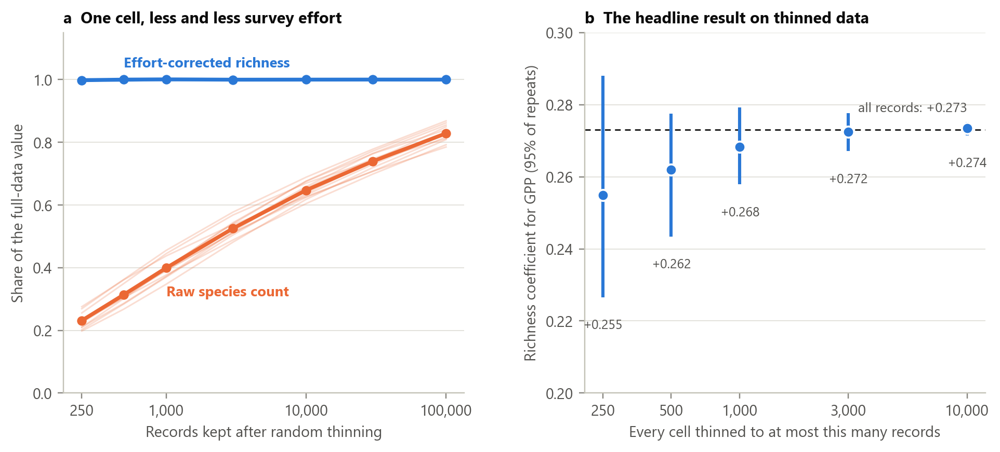
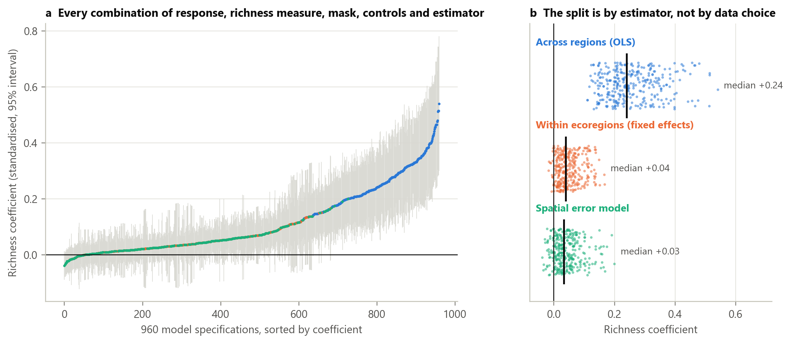
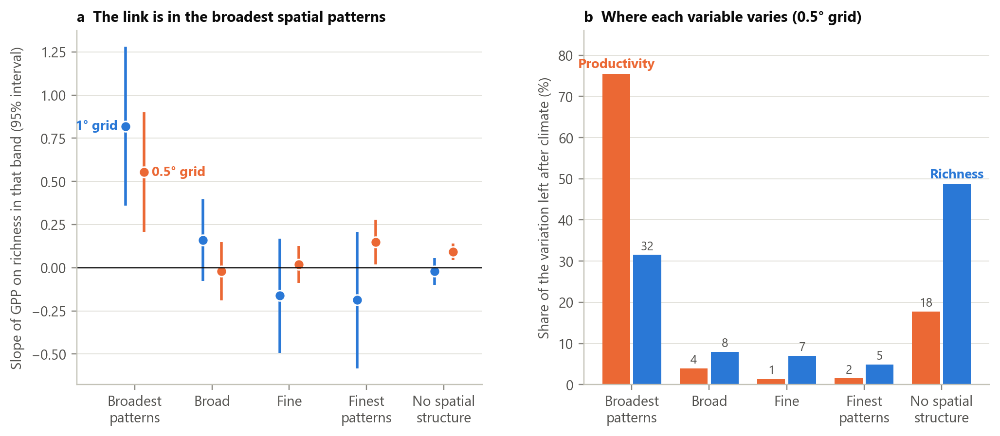
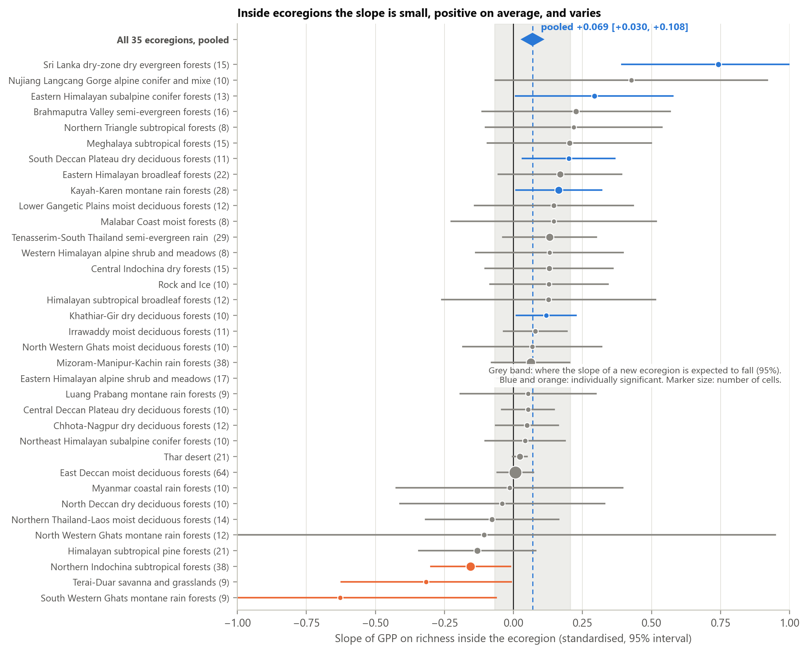
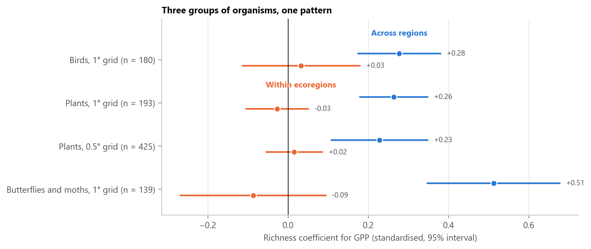
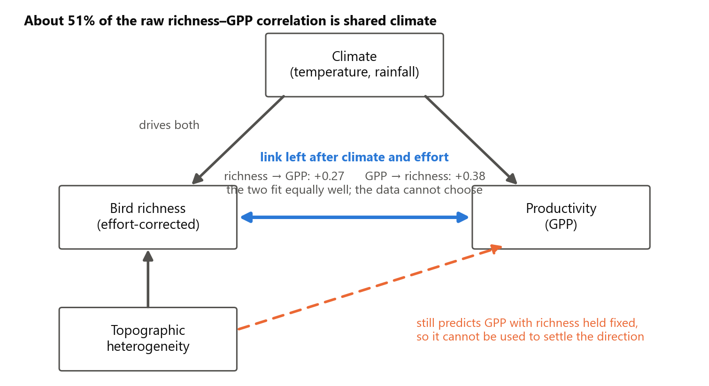
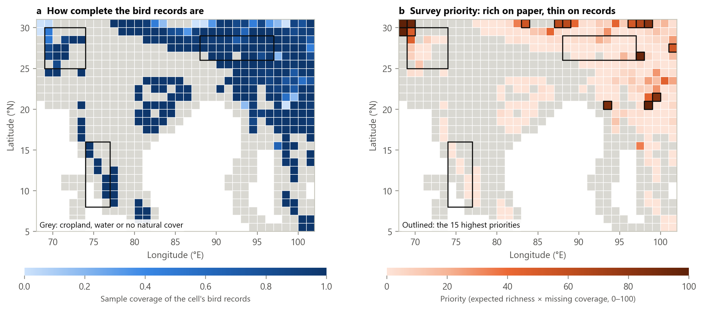

# Biodiversity and Ecosystem Productivity

Course Project 9. Does biodiversity track ecosystem productivity once the uneven
effort behind citizen-science records is corrected? Effort-corrected bird richness
from GBIF against MODIS productivity, on a one-degree grid over South and
Southeast Asia (5–31°N, 68–102°E), with climate controls and a restriction to
natural land cover.

**Explore the data:** [3D terrain map](https://devansh061105.github.io/Course-Project-EVST/interactive_map_3d.html) ·
[flat atlas](https://devansh061105.github.io/Course-Project-EVST/interactive_map.html)

**Slides:** [Project9_Biodiversity_Productivity.pptx](presentation/Project9_Biodiversity_Productivity.pptx) (16 slides with speaker notes)

**Resuming work on the project? Start with [HANDOFF.md](HANDOFF.md).**

## What we found

**1. Raw species counts mostly map where birdwatchers go; the correction works.**
Raw richness correlates r = 0.81 with survey effort, corrected richness r = 0.24.
Thinning a well-surveyed cell to 250 records cuts its raw count to 23% of the full
value and leaves corrected richness at 99.8%.



**2. Across regions, richer cells are more productive. Within a region, barely.**
With straight-line climate controls the coefficient is +0.27 across the whole
area and about +0.03 to +0.06 inside ecoregions. That holds across 960 versions
of the model: the result depends on whether you compare across or within
regions, not on any data choice.



**3. About half of that across-region link is curved climate, and what is left
is a small effect at every scale.** With flexible, non-linear controls the
across-region coefficient falls to +0.14–0.17 at 1° and +0.07 at 0.5°, close to
the within-ecoregion value. Split by spatial scale, the large slope sits only in
the broadest patterns, patches of 700–800 km.



Inside ecoregions the effect is small but real at 0.5° (pooled +0.069 over 35
ecoregions), and in every sample it is shown to be less than half the
across-region one.



**4. It is not specific to birds.** Vascular plants and butterflies and moths,
each recorded by a different community of observers, show the same pattern.



**5. The relationship is a straight line, not a hump,** and the data cannot say
which way it runs: "richness drives productivity" and "productivity drives
richness" fit equally well.



**6. Richer cells are not steadier once climate is accounted for,** and the
slope does not differ with how much land is protected (though the protected-area
data for India and China are too incomplete to say much).

**7. Where the records run out.** Bird data are close to complete at this grain
across India, Nepal, Thailand and Sri Lanka, and thin in western Pakistan, upland
Myanmar and the Tibetan margin.



## Read the results
| Document | What it covers |
|---|---|
| [PAPER_CLAIMS.md](docs/PAPER_CLAIMS.md) | Each claim a paper could make, its evidence, figure and caveat |
| [RESULTS_INFERENCE.md](docs/RESULTS_INFERENCE.md) | Flexible controls, measurement error, bounds on the within-region effect, slopes by ecoregion, spatial scale |
| [RESULTS_ADJUDICATION.md](docs/RESULTS_ADJUDICATION.md) | The interpretation of the linear models |
| [RESULTS_EXTENSION_A.md](docs/RESULTS_EXTENSION_A.md) | A: naive against corrected, and the thinning experiment |
| [RESULTS_EXTENSION_B.md](docs/RESULTS_EXTENSION_B.md) | B: linear against hump-shaped, quadratic and flexible curves |
| [RESULTS_EXTENSION_C.md](docs/RESULTS_EXTENSION_C.md), [RESULTS_LOCAL_SLOPES.md](docs/RESULTS_LOCAL_SLOPES.md) | C: three case-study regions, and the slope fitted around every cell |
| [RESULTS_EXTENSION_D.md](docs/RESULTS_EXTENSION_D.md) | D: plants and butterflies as second and third taxa |
| [RESULTS_EXTENSION_E.md](docs/RESULTS_EXTENSION_E.md) | E: richness and the year-to-year stability of productivity |
| [RESULTS_EXTENSION_F.md](docs/RESULTS_EXTENSION_F.md) | F: protected land (data-limited) |
| [RESULTS_DIRECTION.md](docs/RESULTS_DIRECTION.md) | Path analysis: which way the link runs |
| [RESULTS_SPEC_CURVE.md](docs/RESULTS_SPEC_CURVE.md) | 960 specifications |
| [RESULTS_SURVEY_GAPS.md](docs/RESULTS_SURVEY_GAPS.md) | Where surveys are thinnest |
| [VERIFICATION.md](docs/VERIFICATION.md), [DECISIONS.md](docs/DECISIONS.md) | What was checked, and why each choice was made |

## Run it
Python 3.13.

```bash
pip install -r requirements.txt pytest
```

```bash
pytest -q tests
```

```bash
python scripts/reproduce_all.py
```

The last command re-runs 34 analysis scripts from the cached data (no network, no
accounts, about 15 minutes) and checks 73 headline numbers against the documented
values. The same two steps run on every push (`.github/workflows/checks.yml`).

Rebuild the figures with `python scripts/make_figures.py`, `make_figures_2.py` and
`make_figures_3.py`, and the maps with
`python scripts/build_interactive_map.py`.

## Data
- Birds, plants, butterflies and moths: GBIF occurrence records 2000–2024. Bird
  records: derived dataset [doi:10.15468/dd.jf64nx](https://doi.org/10.15468/dd.jf64nx);
  per-cell data and code on Zenodo, [doi:10.5281/zenodo.23264805](https://doi.org/10.5281/zenodo.23264805).
  The plant and butterfly records do not have a DOI yet.
- Productivity and greenness: MODIS MOD17A3HGF and MOD13Q1. Climate: ERA5-Land.
  Land cover: ESA WorldCover v200. Ecoregions: RESOLVE 2017. Elevation: SRTM.
- Full citations: [LITERATURE_NOTES.md](docs/LITERATURE_NOTES.md). Column
  definitions: [CODEBOOK.md](data/final/CODEBOOK.md).
